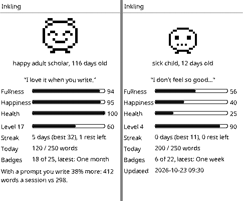

# InkDeck

A super-minimal **markdown writing** firmware for the Xteink **X3/X4** (ESP32-C3
e-ink devices). Pair a Bluetooth HID input device, write `.md` files to the SD
card, and manage them — create/rename/delete files and folders — from the device
buttons or a connected keyboard. Keep a daily journal and sync it with
[GitJournal](https://github.com/gitjournal/gitjournal) over Wi-Fi.

Built entirely on the [FreeInk SDK](https://github.com/Free-Ink/freeink-sdk):
`FreeInkApp`/`FreeInkUI` for the UI, `SDCardManager` for storage, `XteinkDetect`
for X3/X4 auto-detection, and two pieces added to the SDK for this firmware:

- **`BleKeyboardHost`** (`libs/network/BleKeyboardHost`) — a BLE HID host for
  keyboards, page turners, and similar peripherals, capability-gated by
  `FREEINK_CAP_BLE_HID_HOST`. See the SDK's
  `docs/ble-keyboard-host.md`.
- **`textArea`** — a multi-line scrolling editor component in FreeInkUI.

> **Bluetooth is BLE only.** The ESP32-C3 has no Bluetooth Classic radio, so
> Classic-only keyboards cannot connect. Most modern wireless/compact keyboards
> and page turners are BLE.

## Using it

- **Browser** — the SD card file list (folders first, then `.md` files). Navigate
  with the device buttons or a connected keyboard's arrows/Enter; `Back` leaves a
  folder.
  - **New file / New folder / Rename / Delete** via the on-screen menu.
  - **Bluetooth** screen: scan, pair, connect, and forget HID devices.
- **Editor** — type markdown as plain text with soft word-wrap and a caret.
  - `Ctrl-S` save · `Esc` back to the browser (prompts if unsaved) · arrows /
    Home / End / PageUp / PageDown to move · Backspace / Delete to edit.
  - `Cmd/Ctrl-Shift-P` pick a [journaling prompt](#journaling-prompts).
- **Name entry** (new file/folder, rename) **requires a connected keyboard** —
  you'll be prompted to pair one first.
- **Renaming a note updates links to it** in every other note, in the formats
  GitJournal understands: `[[Old name]]`, `[[Old name|text]]`,
  `[[folder/Old name]]`, `[text](../folder/Old%20name.md)` and
  `[label]: Old%20name.md`. Links in code and front matter are left alone. If
  another note has the same name, bare `[[Old name]]` links are ambiguous and
  kept as they are (links with a path are still updated). Notes inside the
  notes folder are updated when renaming a note there; elsewhere, the whole
  card. Folder renames don't update links yet.
- **Today's journal** (menu, or `T` in the browser) — opens `YYYY-MM-DD.md`
  for today in the notes folder, creating it with GitJournal front matter, and
  adds a `## HH:MM` heading for each writing session. Leaving without typing
  discards the heading (and doesn't create an empty entry).
- **Sync** (menu) — turns Bluetooth off, joins Wi-Fi, sets the clock over NTP,
  syncs the notes folder with your GitJournal repository on GitHub, then turns
  Wi-Fi off and Bluetooth back on.
- **Set date/time** (menu) — set the clock by hand (`YYYY-MM-DD HH:MM`) when
  there's no Wi-Fi.

## Writing times and location

Each time *Today's journal* opens, InkDeck starts a **session** (the
`## HH:MM` heading) and records, in the entry's front matter:

- when the session opened and when you last typed,
- active typing time (pauses over a minute don't count), keystrokes, and words
  added,
- one **part** per paragraph written, each with its start and end time,
  active time, and words,
- optionally, **where** you were, read from your phone over Bluetooth LE.

```yaml
sessions:
  - start: 2026-10-23T10:00:00-07:00
    end: 2026-10-23T10:05:18-07:00
    active_s: 18
    keys: 82
    words: 15
    location: {lat: 45.523100, lon: -122.676500, accuracy_m: 12, time: 2026-10-23T09:59:50-07:00, source: phone, place: "Portland"}
    parts:
      - {start: "10:00:00", end: "10:00:07", active_s: 7, words: 6}
      - {start: "10:05:07", end: "10:05:18", active_s: 11, words: 9}
```

The record is updated on every save, syncs with the entry, and GitJournal
keeps front matter it doesn't use, so the history stays with your notes.

Settings: `writing_stats = on|off` (default on), `location = off|phone`
(default off), `location_every = 15` (minutes; sessions opened sooner reuse the
last location). Phone location needs an app on the phone serving InkDeck's
location service: the contract is in [docs/phone-location.md](docs/phone-location.md),
including how to test with nRF Connect.

## Stats

- **On the X4**: *Menu → Stats* shows today, this week and month (words,
  active time, sessions), your streak and best streak, best day, average
  session and typing speed, how much typing you deleted, syncs, keyboard
  time, and a chart of when in the day you write (last 30 days).
- **Usage log**: everything above comes from `<notes>/_inkdeck/usage/YYYY-MM.csv`,
  which records every editing session (any file), creates, renames, deletes,
  syncs, boots and sleeps with the battery level, and keyboard connections.
  It syncs with your journal (and is hidden in the X4's file browser).
- **Dashboard**: [`server/`](server/README.md) is a small Docker service that
  reads your repo and charts it all: writing calendar, words and time per day,
  typing speed, weekday × hour, habits, places map, per-day timelines,
  battery and files.

## Journaling prompts

Not sure what to write? When Today's entry opens for the first time each day,
InkDeck offers a prompt (*Back* skips it). You can also pick one any time with
`Cmd/Ctrl-Shift-P`, or with *Menu → Journal prompt*.

- **Today's prompt**: a different one each day, the same on the X4 and the
  dashboard.
- **For you**: up to five picked by the [server](server/README.md) from your own
  journal. They include a look back at what you wrote on this day a week, month or
  year ago (quoting your entry), and a prompt that fits your latest check-in (high
  stress, little sleep, low energy). There's also one from the kind of prompt you
  write most with, and a kind you haven't tried.
- **Surprise me**, or **browse** about 85 prompts in 13 categories: Just start
  (2 minutes), Gratitude, Looking back on the day, Feelings, Untangling stress,
  Goals, People, Body and energy, Learning, Memories, Play, Values, and Tiny
  check-ins. Each prompt says **why it helps**, shown as you scroll.
- The prompt goes into the entry as a quote (`> **Prompt:** ...`), and its id is
  recorded with the session (`prompts: [grat-three]`). If you leave without
  writing, nothing is saved.
- **Your own prompts**: add them to `<notes>/_inkdeck/prompts.txt` (same format
  as [`prompts/library.txt`](prompts/library.txt)). It syncs, so you can edit it
  in GitJournal.
- **Does it help?** The server compares your own numbers and says what they show,
  only once there's enough data:
  - how much more you write with a prompt;
  - your evening stress or energy on days you journal vs days you don't (from check-ins);
  - which kinds of prompt you write most after.
  The top finding is on *Menu → Pet*; all of them are on the dashboard.
- Setting `prompts = ask` (the default; first session of the day), `always`, or `off`.


## Pet, levels and weather

Run the [server](server/README.md) with `WRITE_BACK=1` and it becomes a
companion for your journal:

- **A pet you keep alive by writing.** An egg hatches after 3 writing days and
  grows up over two months; writing feeds it, check-ins, streaks and badges
  cheer it up, and skipping days makes it hungry, sad and ill (it hibernates
  until you come back). *Menu → Pet* on the X4 shows it, and it eats what you
  write today straight away.
- **Levels, XP, streaks (with rest days), a daily word goal and 22 achievements.**
- **Weather, sun and air quality** added to each session and day of finished
  entries (from Open-Meteo, at the phone location or `HOME_LOCATION`).

The server works it all out from the repo and commits `_inkdeck/companion.md`;
the X4 just syncs it and draws it.



## Installing from the browser

The web flasher installs InkDeck from Chrome or Edge on a computer, with no
toolchain, and sends it everything it needs over the same USB cable:

1. **Settings**: fill in the repository URL from GitJournal, an access token,
   the time zone (pre-selected from your browser), and optionally Wi-Fi.
2. **Install**: plug the X4 in over USB-C, press *Connect and install* and
   pick `USB JTAG/serial debug unit`. When the X4 restarts, the installer asks
   for Wi-Fi and checks it ([Improv Serial](https://www.improv-wifi.com/serial/)).
3. **Done**: when the installer closes, the page sends your settings and the
   X4 shows *Settings received*. Choose *Sync* to pull your journal.
   *Send settings only* does the same for an X4 already running InkDeck.

Settings travel as Improv packets with InkDeck's own command (`0x80`, one or
more `key = value` lines per packet; see `src/Improv.h`), so they need no
Wi-Fi. The page itself saves nothing.

Alternatively, after the Wi-Fi step choose *Visit Device*: the X4 serves a
setup page on your network (address and QR code on its screen) with the same
fields.

Later changes: *Menu &rarr; Setup over Wi-Fi* brings the same page back.
Settings entered this way are stored on the device (NVS). `/inkdeck.txt` on
the SD card still overrides them, and the page warns when it does.

**Publishing the flasher**: `.github/workflows/web-flasher.yml` builds the
firmware and deploys the page to GitHub Pages on every push to `master`.
Turn it on once under *Settings &rarr; Pages &rarr; Source: GitHub Actions*.
**Running it locally**:

```sh
pio run && python3 tools/build_web_flasher.py
python3 -m http.server -d .pio/web-flasher 8000   # open http://localhost:8000 in Chrome
```

The packaging step refuses builds with `flash-config.txt` settings baked in,
so a published flasher never carries your token or Wi-Fi password.

## Journaling with GitJournal

[GitJournal](https://github.com/gitjournal/gitjournal) keeps notes as Markdown
files in a git repository. InkDeck writes entries the same way and syncs them
through the GitHub REST API, so entries written on the device show up in the
app (and vice versa).

1. Set up GitJournal with a **GitHub** repository (an existing one is fine).
   Optionally set *Settings → Journal → file name format* to **Date Only** so
   entries from the phone are named like InkDeck's (`2026-10-22.md`).
2. Create a [fine-grained personal access token](https://github.com/settings/personal-access-tokens/new)
   limited to that repository, with **Contents: Read and write**.
3. Give InkDeck the repo, token and Wi-Fi:

   - **With the web flasher** (easiest): see
     [Installing from the browser](#installing-from-the-browser).

   - **When building it yourself**: copy `flash-config.example.txt` to
     `flash-config.txt` (git-ignored), fill it in, then `pio run -t upload`.
     The build prints what it baked in (secrets show as `(set)`):

     ```ini
     repo_url = git@github.com:you/journal.git
     git_token = github_pat_...
     wifi_ssid = MyNetwork
     wifi_password = secret
     timezone = PST8PDT,M3.2.0,M11.1.0
     ```

     Environment variables such as `INKDECK_REPO_URL` / `INKDECK_GIT_TOKEN`
     work too and override the file.

   - **On the SD card**: pick **Sync** once and InkDeck creates `/inkdeck.txt`
     with the same keys. Fill it in on a computer, or open it in InkDeck's
     browser and edit it on the device. Any value set there overrides the
     baked-in one; empty values keep it.

   `repo_url` takes any form you have to hand: the SSH URL GitJournal shows,
   `https://github.com/you/journal`, or just `you/journal`. Also available:
   `branch` (default `main`), `notes_folder` (SD folder mirrored with the repo
   root, default `/Journal`) and `journal_subfolder` (where Today's entries
   go inside it; empty = top level). Comments must be on their own line (`#`
   first), since passwords may contain `#`.

4. **Sync**. The first run downloads the repository's `.md` files into
   the notes folder.

How sync works:

- Only `*.md` files are synced; other files and hidden folders are ignored.
- Each upload or delete is a separate commit (`InkDeck: update …`); GitJournal
  picks them up on its next pull.
- `<notes>/.inkdeck-sync` records each file's git blob id from the last sync,
  so InkDeck can tell edits made on the device, edits made in the app, and
  deletions apart. Deleting a note on either side deletes it on the other.
- If a note changed on **both** sides, nothing is lost: the device's version is
  kept as `<name> (InkDeck conflict).md` (here and on GitHub) next to the app's
  version.
- Changing `repo_url` or `branch` makes the next sync a merge: no
  deletions, and differing files are kept as conflict copies.

Notes and limits:

- The X4 has no clock chip. The time survives sleep (the ESP32-C3 keeps
  counting in deep sleep) but not a reset or a flat battery; Sync or Set
  date/time restores it.
- Sync needs 2.4 GHz Wi-Fi, and GitHub only (no GitLab/Gitea or SSH yet).
- Up to ~1000 synced notes. Each note opens up to `INKDECK_DOC_CAPACITY`
  (16 KB by default); larger files open truncated.
- `/inkdeck.txt` holds your Wi-Fi password and token in plain text on the SD
  card, and baked-in values can be read back out of the firmware by anyone
  with the device and a USB cable. Use a token limited to the journal
  repository.

## Building

This project consumes the FreeInk SDK via PlatformIO `symlink://` lib deps,
exactly like the `escape-hatch` example. The SDK is pinned as the `freeink-sdk/`
git submodule, so clone with submodules:

```sh
git clone --recurse-submodules <inkdeck-url>
# or, in an existing checkout:
git submodule update --init freeink-sdk
```

```sh
pio run                 # build (env: default — X3 + X4 in one binary)
pio run -t upload       # flash over USB
pio device monitor      # serial @ 115200
```

To bump the SDK, check out the new commit in the submodule and commit the
pointer:

```sh
git -C freeink-sdk fetch origin && git -C freeink-sdk checkout origin/main
git add freeink-sdk && git commit -m "Bump freeink-sdk"
```

For SDK development, an untracked `platformio.local.ini` can override the
`lib_deps` with absolute symlinks to a separate SDK working copy, so SDK changes
iterate without touching the submodule.

## Status and roadmap

What is done, what is not, and how to pick the work up: [docs/STATUS.md](docs/STATUS.md).
Host tests: `test/host/run.sh`.

## Layout

```
src/
  main.cpp       lifecycle, input routing, refresh policy (FreeInkApp loop)
  AppState.h     screen enum + shared app state
  Document.*     the open file: fixed-capacity in-RAM text buffer + load/save
  screens.*      browser, editor, file-ops menu, name entry, bluetooth, sync screens
  Config.*       settings: baked-in flash-config.txt, then /inkdeck.txt
  Clock.*        NTP / manual clock, GitJournal timestamps
  Journal.*      today's entry (YYYY-MM-DD.md with front matter)
  SyncFlow.*     Sync screen work: Bluetooth off, Wi-Fi, NTP, GitHub, back on
  GitSync.*      two-way sync with a GitHub repo over the REST API
  TreeListing.*  streaming parser for GitHub's recursive tree listing
  SyncUtil.*     pure helpers: git blob ids, base64, escaping, repo URLs, sync decisions
  Net.*          Wi-Fi sessions (Bluetooth paused while Wi-Fi is up)
  Improv.*       Improv Serial: Wi-Fi credentials from the web flasher over USB
  SetupFlow.*    Setup screen: join Wi-Fi, show the page address + QR code
  SetupServer.*  the setup web page (repo URL, token, time zone, folders)
  WritingStats.* session and paragraph writing times, written into front matter
  PhoneLocation.* reads the session location from the phone's GATT server
  JournalMeta.*  pure helpers: session YAML, typing counters, location format, word counts
  UsageLog.*     the usage log (any editing session, syncs, battery, keyboard)
  UsageStats.*   pure: usage log format and the Stats screen's totals
  StatsScreen.cpp the Stats screen
  Links.*        after a rename, rewrites links to the note across the notes
  LinkRewrite.*  pure link rewriting (GitJournal's wiki/markdown link rules)
tools/
  flash_config.py       pre-build: bakes flash-config.txt + the version into the firmware
  merge_bin.py          post-build: one image for the web flasher (inkdeck-full.bin)
  build_web_flasher.py  assembles web/ + image + manifest.json into a site
server/          stats dashboard (Python, Docker): reads the repo, serves charts
web/
  index.html     the browser installer page (ESP Web Tools + settings form)
  settings.js    sends settings to the X4 over Web Serial (Improv command 0x80)
  timezones.js   IANA -> POSIX time zones (same table as the device's setup page)
```
